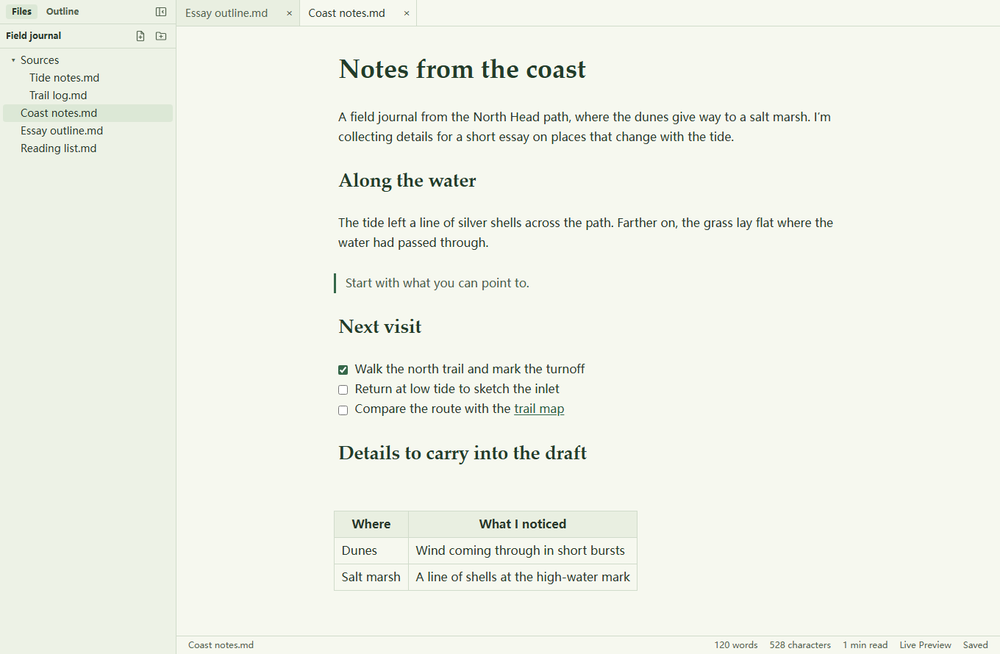
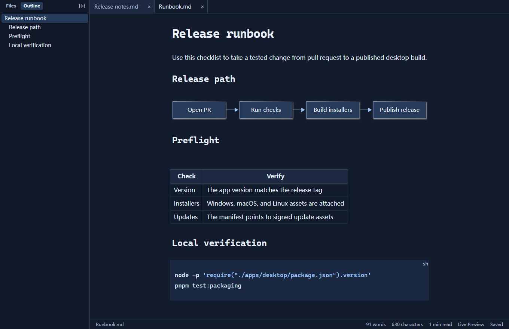
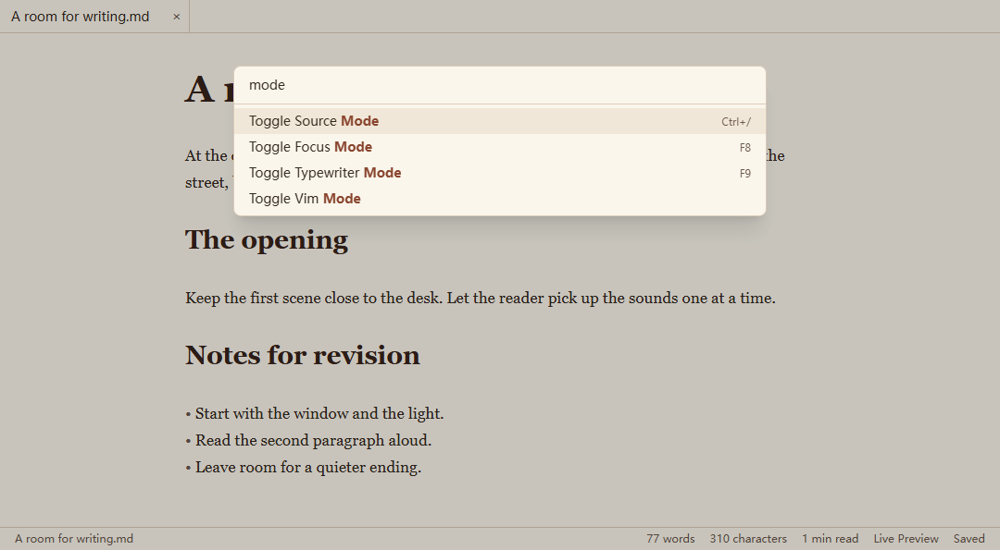

<p align="center">
  
</p>

<h1 align="center">MINT</h1>

<p align="center">An open-source desktop Markdown editor with live preview.</p>

<p align="center">
  <a href="https://github.com/amemiya02/MINT/releases/latest"></a>
  <a href="https://github.com/amemiya02/MINT/actions/workflows/ci.yml"></a>
  <a href="LICENSE"></a>
</p>

<p align="center">
  <a href="https://github.com/amemiya02/MINT/releases/latest"><strong>Download</strong></a> ·
  <a href="#quick-start">Quick start</a> ·
  <a href="#run-from-source">Run from source</a> ·
  <a href="README.zh-CN.md">简体中文</a>
</p>

**MINT Is Not Typora.** Open a Markdown file and edit it in place. Live preview renders the document as you type and reveals the Markdown syntax at the cursor. Saving preserves the original bytes outside your edits.



## Install

Choose an installer from the [latest release](https://github.com/amemiya02/MINT/releases/latest).

| Platform | Installer |
| --- | --- |
| Windows (x64) | `MINT_<version>_x64-setup.exe` or `MINT_<version>_x64_en-US.msi` |
| macOS (Apple silicon) | `MINT_<version>_aarch64.dmg` |
| macOS (Intel) | `MINT_<version>_x64.dmg` |
| Linux (x64) | `.AppImage`, `.deb`, or `.rpm` |

MINT can update itself on Windows, macOS, and AppImage. For `.deb` and `.rpm` installs, download and install the newer package.

<details>
<summary>First launch on macOS and Windows</summary>

The installers currently ship without platform code signing.

- On **macOS**, move MINT to Applications. If macOS reports the app as damaged or blocks it from opening, remove the quarantine attribute with `xattr -dr com.apple.quarantine /Applications/MINT.app`.
- On **Windows**, if SmartScreen shows a warning for the downloaded installer, select **More info → Run anyway**.

</details>

## Quick start

Open an existing `.md` file, or choose **File → Open Folder** to keep a set of notes in the sidebar. MINT saves edits to the files on disk.

| Action | macOS | Windows / Linux |
| --- | --- | --- |
| Open a document | `⌘O` | `Ctrl+O` |
| Find a file in the open folder | `⌘P` | `Ctrl+P` |
| Open the command palette | `⌘⇧P` | `Ctrl+Shift+P` |
| Toggle Source Mode | `⌘/` | `Ctrl+/` |

## Features

- **Write in live preview or source mode.** Use focus mode, typewriter mode, or Vim bindings while you work. Customize shortcuts in Settings.
- **Work with a folder of notes.** Browse the file tree, keep documents open in tabs and windows, and search across the open folder.
- **Write rich Markdown.** Add GitHub Flavored Markdown tables and task lists, KaTeX math, Mermaid diagrams, front matter, footnotes, and inline HTML.
- **Pick your writing setup.** Choose among four [built-in themes](docs/themes.md), with light and dark appearances, or load your own CSS. The interface supports English and Simplified Chinese.
- **Keep and share drafts.** Autosave and crash recovery help you resume interrupted work. Paste images into an assets folder and export to HTML or PDF.

## MINT in use

### Technical notes

Browse the outline of a runbook while live preview renders its Mermaid diagram, table, and shell commands.



### Command palette

Search for a command by name to switch writing modes or run another action from the keyboard.



## Run from source

Install Node.js 24+, pnpm 10+, stable Rust, and the [Tauri prerequisites](https://v2.tauri.app/start/prerequisites/) for your platform.

```sh
git clone https://github.com/amemiya02/MINT.git
cd MINT
pnpm install --frozen-lockfile
pnpm dev
```

Run `pnpm build` to build installers for your platform.

## Contributing

Report a bug or propose a change in [Issues](https://github.com/amemiya02/MINT/issues). The [contributing guide](CONTRIBUTING.md) covers the repository layout, tests, and release process.

## License

[MIT](LICENSE)
