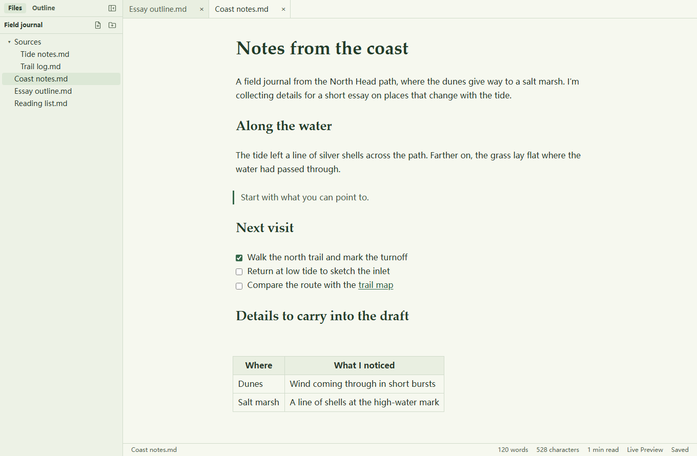
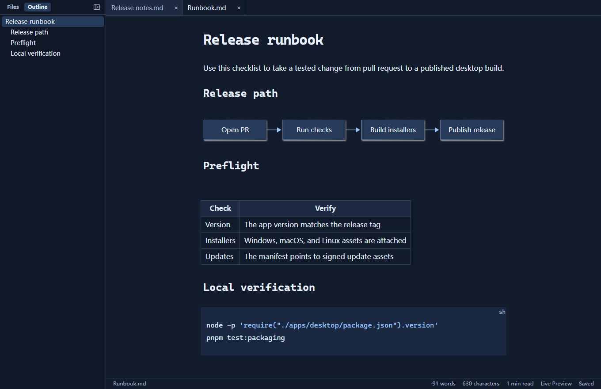
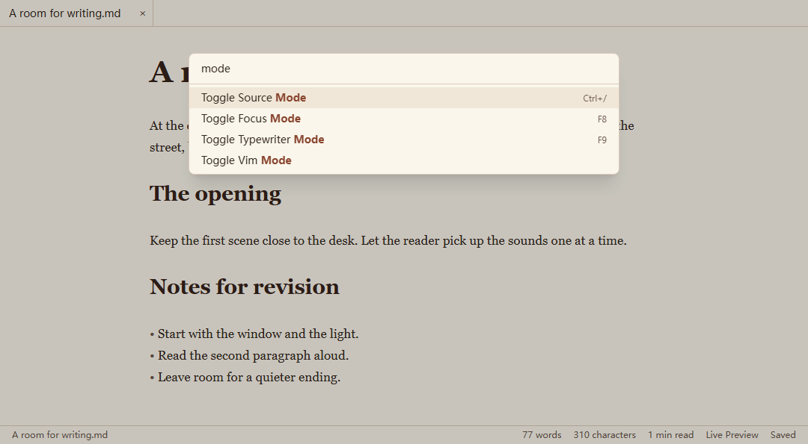

<p align="center">
  
</p>

<h1 align="center">MINT</h1>

<p align="center">MINT = <strong>M</strong>INT <strong>I</strong>s <strong>N</strong>ot <strong>T</strong>ypora</p>

<p align="center">支持实时预览的开源桌面 Markdown 编辑器。</p>

<p align="center">
  <a href="https://github.com/amemiya02/MINT/releases/latest"></a>
  <a href="https://github.com/amemiya02/MINT/actions/workflows/ci.yml"></a>
  <a href="LICENSE"></a>
</p>

<p align="center">
  <a href="https://github.com/amemiya02/MINT/releases/latest"><strong>下载</strong></a> ·
  <a href="#快速上手">快速上手</a> ·
  <a href="#从源码运行">从源码运行</a> ·
  <a href="README.md">English</a>
</p>

直接打开和编辑磁盘上的 Markdown 文件。实时预览会在写作时渲染文档，并在光标处显露 Markdown 标记。保存时，编辑范围之外的内容按原字节保留。



## 安装

在[最新发布页](https://github.com/amemiya02/MINT/releases/latest)选择适合你的安装包。

| 平台 | 安装包 |
| --- | --- |
| Windows（x64） | `MINT_<版本>_x64-setup.exe` 或 `MINT_<版本>_x64_en-US.msi` |
| macOS（Apple 芯片） | `MINT_<版本>_aarch64.dmg` |
| macOS（Intel） | `MINT_<版本>_x64.dmg` |
| Linux（x64） | `.AppImage`、`.deb` 或 `.rpm` |

Windows、macOS 和 AppImage 支持应用内更新。`.deb` 和 `.rpm` 用户可下载并安装新版软件包。

<details>
<summary>macOS 和 Windows 首次启动</summary>

目前安装包尚未做系统级代码签名。

- 在 **macOS** 上，将 MINT 移入「应用程序」。如果系统提示应用已损坏或无法打开，可运行 `xattr -dr com.apple.quarantine /Applications/MINT.app` 来移除此应用的隔离属性。
- 在 **Windows** 上，如果 SmartScreen 拦截安装包，选择「更多信息 → 仍要运行」。

</details>

## 快速上手

打开现有的 `.md` 文件，或在「文件」菜单中打开文件夹，让相关笔记显示在侧边栏。编辑会保存到磁盘上的原文件。

| 操作 | macOS | Windows / Linux |
| --- | --- | --- |
| 打开文档 | `⌘O` | `Ctrl+O` |
| 快速打开当前文件夹中的文件 | `⌘P` | `Ctrl+P` |
| 打开命令面板 | `⌘⇧P` | `Ctrl+Shift+P` |
| 切换源码模式 | `⌘/` | `Ctrl+/` |

## 功能

- **两种编辑模式**。在实时预览和源码模式之间切换。支持专注模式、打字机模式、Vim 键位和自定义快捷键。
- **管理一组文档**。用文件树浏览目录，在多个标签页和窗口中打开文档，也可以搜索整个文件夹。
- **丰富的 Markdown 内容**。支持 GitHub Flavored Markdown 表格和任务列表、KaTeX 公式、Mermaid 图表、Front Matter、脚注及内联 HTML。
- **自定义写作环境**。24 套[内置主题](docs/themes.md)均支持亮色和暗色，默认使用 GitHub 主题，也可加载自定义 CSS。界面支持简体中文和英文。
- **保存和分享文稿**。支持自动保存、崩溃恢复、粘贴图片至资源目录，以及 HTML 和 PDF 导出。

## 使用截图

### 技术文档

通过大纲定位章节，在实时预览中阅读 Mermaid 流程图、表格和命令块。



### 命令面板

输入命令名称，用键盘切换源码、专注或打字机模式，也可以查找其他操作。



## 从源码运行

需要 Node.js 24+、pnpm 10+、稳定版 Rust，以及对应平台的 [Tauri 依赖](https://v2.tauri.app/start/prerequisites/)。

```sh
git clone https://github.com/amemiya02/MINT.git
cd MINT
pnpm install --frozen-lockfile
pnpm dev
```

运行 `pnpm build` 可以构建当前平台的安装包。

## 参与贡献

欢迎在 [Issues](https://github.com/amemiya02/MINT/issues) 报告问题或提出建议。仓库结构、测试命令和发布流程见[贡献指南](CONTRIBUTING.md)。

## 许可证

[MIT](LICENSE)
